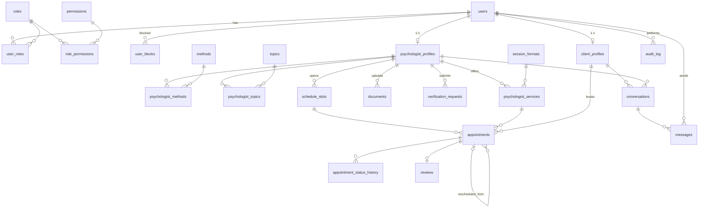

# База данных «Рядом»

| Файл | Содержимое |
|---|---|
| [schema.sql](schema.sql) | Логическая схема PostgreSQL 16: таблицы, ограничения, индексы, триггеры, представления |
| [seed.sql](seed.sql) | Роли, права доступа, справочники (методы, темы, форматы) |
| [demo.sql](demo.sql) | Демо-аккаунты: клиент, психолог, модератор, заблокированный клиент (пароль `demo1234`) |
| [redis.md](redis.md) | Структура ключей и каналов Redis |

## Запуск

```bash
docker run -d --name ryadom-db -e POSTGRES_PASSWORD=postgres -e POSTGRES_DB=ryadom -p 5432:5432 postgres:16
docker exec -i ryadom-db psql -U postgres -d ryadom < schema.sql
docker exec -i ryadom-db psql -U postgres -d ryadom < seed.sql
```

## Модули схемы

1. **Пользователи и RBAC.** `users`, `roles`, `permissions`, `role_permissions`, `user_roles`,
   `user_blocks` (история блокировок).
2. **Профили.** `client_profiles`, `psychologist_profiles`, справочники `methods`, `topics`,
   `session_formats`, связи `psychologist_methods`, `psychologist_topics`, `psychologist_services` (цена для каждого формата).
3. **Верификация.** `documents` (дипломы и сертификаты вместе со сведениями из них), `verification_requests`.
4. **Записи.** `schedule_slots`, `appointments`, `appointment_status_history`.
5. **Отзывы.** `reviews`.
6. **Чат.** `conversations`, `messages`.
7. **Служебное.** `audit_log`.

## Бизнес-правила на уровне БД

| Правило | Как обеспечено |
|---|---|
| Слоты одного психолога не пересекаются | `EXCLUDE USING gist` на `tstzrange(starts_at, ends_at)` |
| На один слот — одна действующая запись | частичный уникальный индекс `ux_appointments_active_slot` |
| Слот и услуга принадлежат психологу из записи | составные FK `(slot_id, psychologist_id)` и `(service_id, psychologist_id)` |
| Нельзя записаться на занятый или прошедший слот | триггер `appointment_book_slot` (с `FOR UPDATE` против гонки) |
| Отмена или перенос освобождают слот; любая смена статуса попадает в историю | триггер `appointment_status_change` |
| Отмена и перенос требуют причину | `CHECK` в `appointment_status_history` |
| Завершённую или отменённую запись нельзя изменить | проверка перехода в `appointment_status_change` |
| Цена в истории не меняется при смене прайса | `appointments.price_at_booking` |
| Отзыв — только по своей завершённой консультации, один на консультацию | `reviews.appointment_id UNIQUE` + триггер `review_check_appointment` |
| Рейтинг психолога всегда актуален | триггер `review_recalc_rating` (считает только одобренные отзывы) |
| Опубликовать можно только подтверждённую анкету | `CHECK` в `psychologist_profiles` |
| Решение модератора меняет статус специалиста | триггер `apply_verification_request` |
| Писать в чат могут только участники диалога | триггер `message_before_insert` |
| `users.status` соответствует активной блокировке | триггер `sync_user_block_status` |

Backend передаёт в триггеры текущего пользователя и причину через переменные транзакции:

```sql
BEGIN;
SELECT set_config('app.user_id', '42', true);
SELECT set_config('app.reason',  'Заболел, прошу перенести', true);
UPDATE appointments SET status = 'rescheduled' WHERE id = 7;
COMMIT;
```

## ER-диаграмма

Полная логическая схема со всеми полями и ключами (PK, FK) в нотации «вороньей лапки»: [er-diagram.png](er-diagram.png) · [er-diagram.svg](er-diagram.svg) (для записки, SVG масштабируется без потери качества).
Файл для draw.io – [er-diagram.drawio](er-diagram.drawio): открывается в draw.io, таблицы можно двигать, линии перестроятся сами.
Все три файла собирает из `schema.sql` скрипт `tools/er-drawio.py` (команды – в начале скрипта).
Линиями не показаны служебные ссылки «кто сделал» (`*_by`), `messages.sender_id` и `reviews.client_id/psychologist_id` – они отмечены FK в таблицах, а связь видна через диалог и запись.
Ниже – упрощённая схема только со связями.


